# Mchango

**An open, dignified record of a funeral fundraiser.** Families paste M-Pesa
messages, match them against M-Pesa statements, and publish a calm memorial page
where friends can give, see every contribution and expense, follow pledges
towards the goal, and check that their own contribution arrived.

<p align="center">
  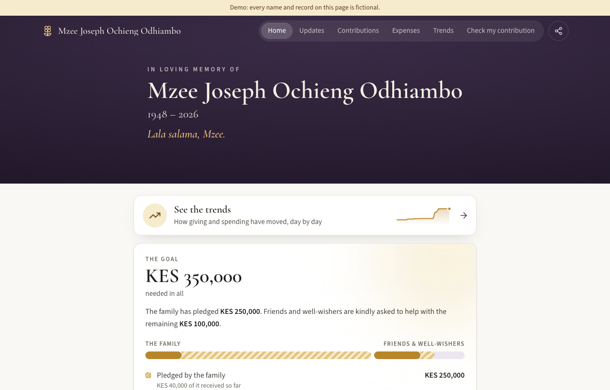
</p>

> Every screenshot uses the built-in **fictional demo data** (`mchango seed`).
> No real names, numbers or photos are shown.

## What it does

| | |
|---|---|
| **Paste an M-Pesa message** | It reads the amount, time, code and sender, and shows them for checking before saving. The sender's name is the public name by default, and can be changed to "Mama Brian" or "Class of 2015", or made anonymous. Pasting the same message twice is refused, and likely duplicates are flagged. |
| **Pledges, family and friends** | The family pledges its share first, and friends and well-wishers are asked for the rest of the target. Each pledge is tagged *family* or *friend*. When money arrives it is linked to its pledge, which moves from **Pledged** to **Part received** to **Received**. |
| **Match M-Pesa statements** | Upload the statement PDF. Each row is matched to a record by account, code and direction, never by amount alone. Missing records are prefilled, and the balance has to add up before a period can be marked complete. |
| **A public memorial page** | The portrait in candle light, how to give (with copy buttons and the name to check before entering the PIN), the funeral details, **Updates** from family meetings, contributions, expenses with receipts, **Trends**, and **Check my contribution** by M-Pesa code. |
| **Statements and updates** | PDF statements of account (full account, money received or money spent, for any period), each with a WhatsApp-ready text version. Quick WhatsApp updates can also be shared from the dashboard. |

Phone numbers, M-Pesa names, full codes, original messages and personal
transactions stay private. The public page is built from an explicit allowlist
of fields.

## A closer look

### The public site

<table>
  <tr>
    <td width="50%">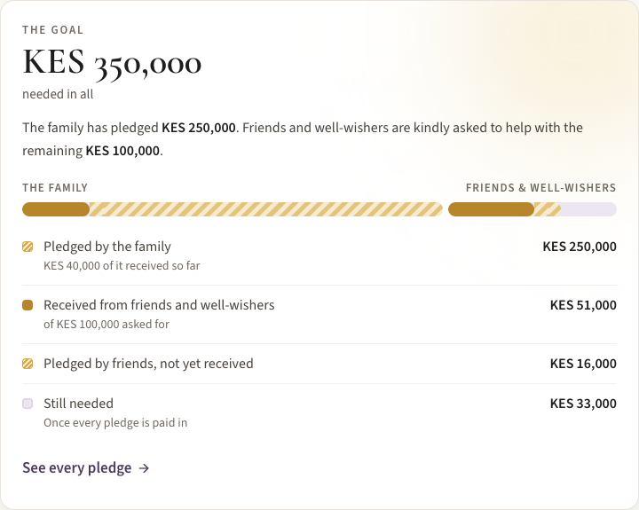<br><sub><b>The goal.</b> Solid gold is money received, hatched gold is pledged but not yet in, and the pale track is still needed.</sub></td>
    <td width="50%">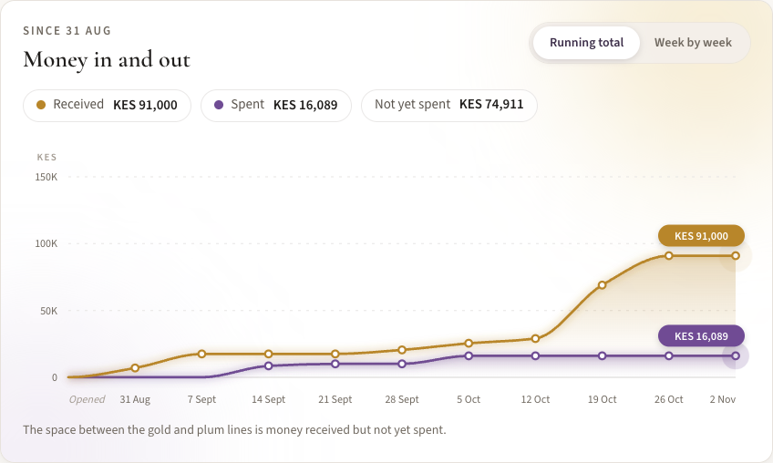<br><sub><b>Trends.</b> Running totals or day by day, with a tooltip on hover or tap, and arrow-key navigation.</sub></td>
  </tr>
  <tr>
    <td width="50%">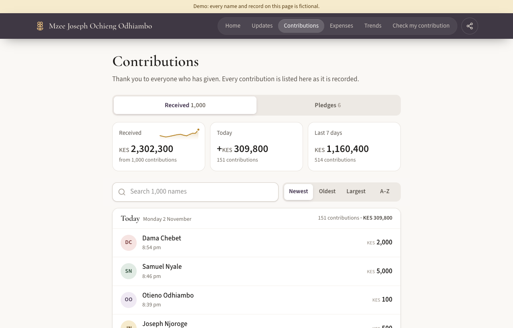<br><sub><b>Contributions, built for a thousand names.</b> Search and sort stay pinned while you scroll. Each day shows its count and total, and rows load as you scroll.</sub></td>
    <td width="50%">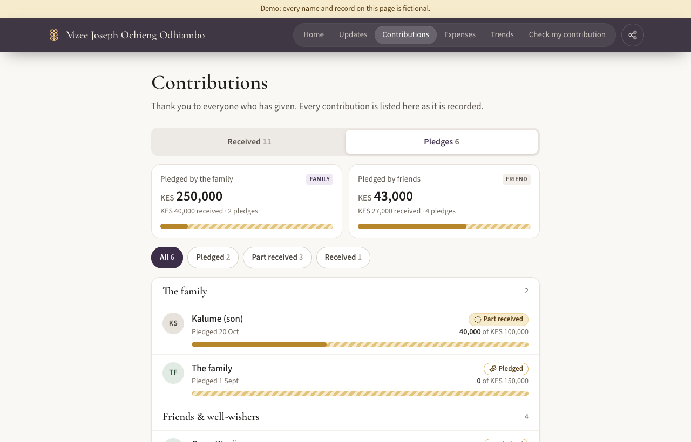<br><sub><b>Pledges.</b> Grouped by family and friends, coloured by status, and updated as the money comes in.</sub></td>
  </tr>
</table>

### On a phone

<p align="center">
  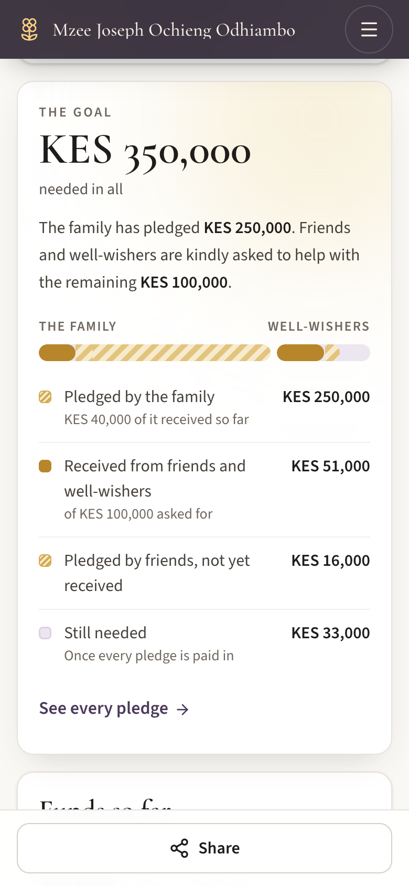
  &nbsp;&nbsp;
  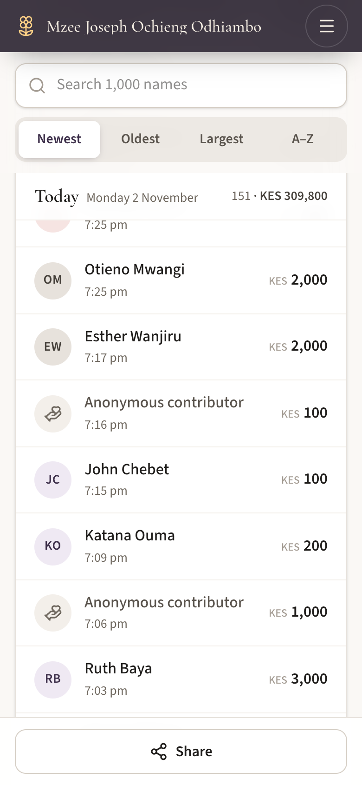
</p>

### Management

<table>
  <tr>
    <td width="50%">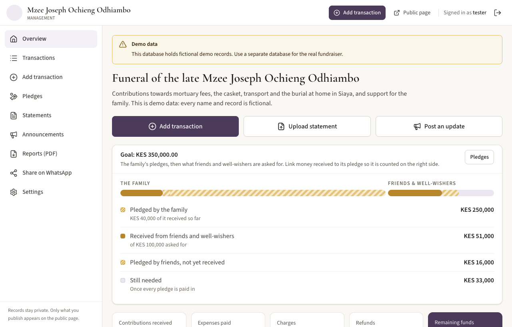<br><sub><b>Overview.</b> Add a transaction, upload a statement or post an update. Shows the goal, totals and anything that needs attention.</sub></td>
    <td width="50%">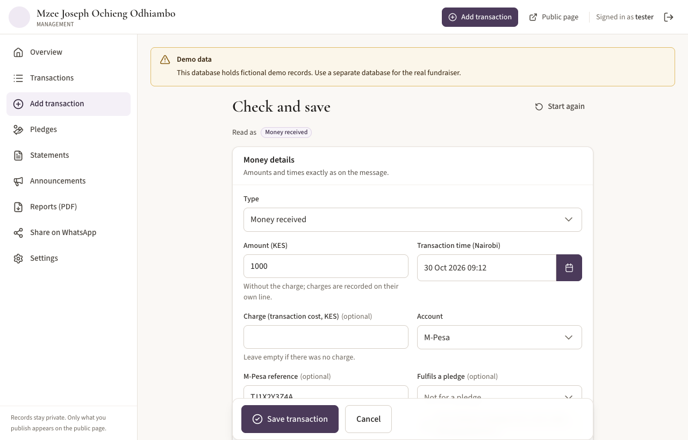<br><sub><b>Paste and confirm.</b> Each field read from the message is shown for checking. If the sender has pledged, linking the payment to that pledge is suggested.</sub></td>
  </tr>
  <tr>
    <td width="50%">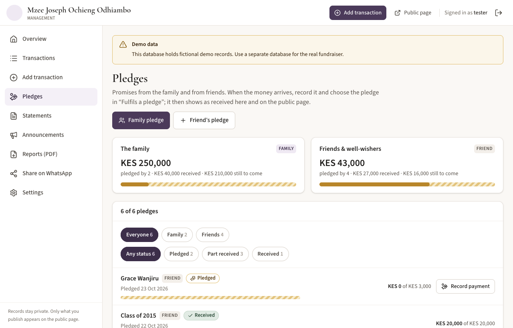<br><sub><b>Pledges.</b> Family and friends totals, filters by status, and <i>Record payment</i> on each pledge.</sub></td>
    <td width="50%">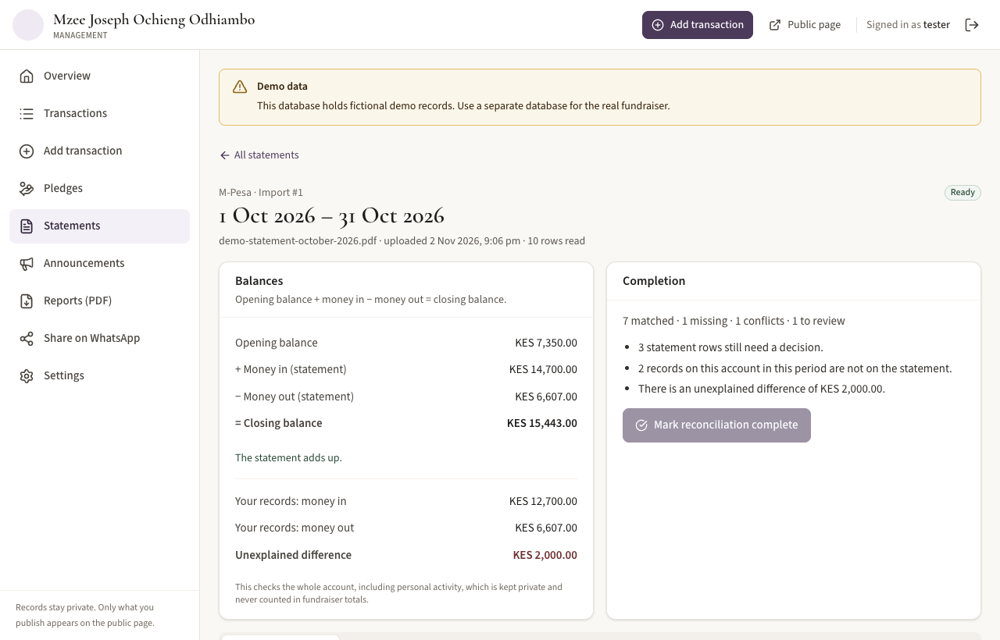<br><sub><b>Statement checks.</b> Opening balance + money in − money out = closing balance, and every difference is explained before a period is marked complete.</sub></td>
  </tr>
  <tr>
    <td width="50%">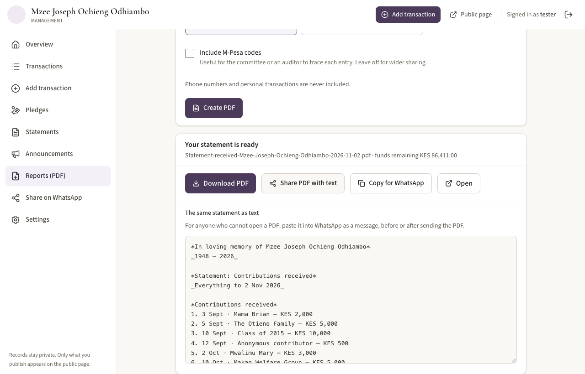<br><sub><b>Reports.</b> Download or share the PDF, or copy the same statement as WhatsApp text for anyone who cannot open a PDF.</sub></td>
    <td width="50%">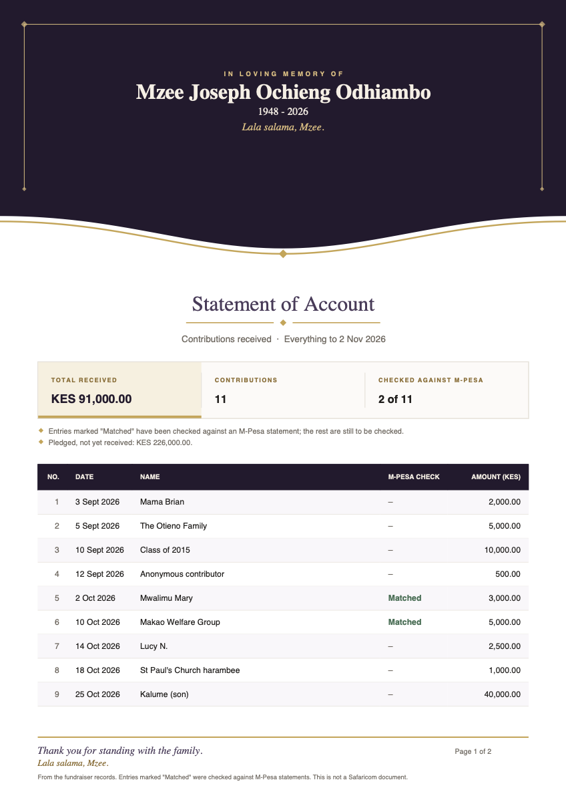<br><sub><b>The PDF.</b> A memorial header, the key figures, then numbered rows, the M-Pesa check and the total.</sub></td>
  </tr>
</table>

## Quick start (Docker Compose)

```sh
cp .env.example .env
docker compose up -d --build
docker compose exec mchango mchango user add <your-name>   # asks for a password
```

- Management: <http://localhost:8081/manage>
- Public page: <http://localhost:8080/>

Under **Settings**, add the memorial photo, the name, dates and tribute, the
target and how to give, then switch on **Publish the public page**. Record the
family's pledge on the **Pledges** page.

To try it with fictional data first, run `mchango seed` against an empty database.
See [docs/operations.md](docs/operations.md) for HTTPS, phone access, backups
and restore, and [`deploy/staging/`](deploy/staging/) for the server playbook.

## How it fits together

```
frontend/   React + TypeScript (Vite, React Router, Tailwind, Lucide). Built to frontend/dist.
  src/public/             The memorial site: home, updates, contributions & pledges, expenses, trends, check
  src/pages/              Management screens (PrimeReact pickers; jsPDF statements), loaded only for managers
backend/    Rust (Axum, Tokio, SQLx/SQLite, tracing). One binary serves the APIs and the built frontend.
  src/capture.rs          M-Pesa SMS parser (deterministic)
  src/transactions/       Cashbook: records, versions (corrections), totals, pledge progress
  src/statements/         Upload, background processing, pdftotext, statement layout
  src/reconciliation.rs   Matching rows to records, balance checks, completion
  src/publication.rs      Public page built from an explicit field allowlist
  src/api/page.rs         index.html with the title and link-preview tags filled in on the server
  migrations/             SQL migrations, applied automatically
docs/       Formats, API notes, operations, screenshots
deploy/     Caddyfile for HTTPS; staging playbook
```

- **Two listeners.** The public listener (`:8080`) serves only the public page.
  The management listener (`:8081`) requires sign-in, checks the Host header and
  guards against CSRF. Keep it on loopback or a private network, for example
  behind an SSH tunnel.
- **SQLite** runs in WAL mode with foreign keys, a 5-second busy timeout, short
  `BEGIN IMMEDIATE` write transactions and explicit migrations.
- **Statement PDFs** are read by one background worker using poppler's
  `pdftotext`. It runs without a shell, with an empty environment, a timeout, an
  output cap and CPU, memory and file-write limits. Interrupted imports are
  retried after a restart.
- **Motion** is calm: the candle-light portrait, curves that draw themselves and
  figures that count up. Everything respects *reduce motion*.

## Money rules

- Amounts are integer **cents** (`KES 1,250.50 = 125050`), parsed without floating
  point. See [docs/api.md](docs/api.md).
- Every total is calculated from the records. There are no editable summary
  numbers.
- **Money received** is a contribution. A **pledge** is a promise: it is never
  counted as received until money linked to it arrives.
- **The goal.** The family's share is the sum of its pledges, and friends and
  well-wishers are asked for the rest of the target. Money linked to a family
  pledge counts on the family's side, so nothing is counted twice.
- An **unpaid bill** is not an expense until it is paid.
- A **withdrawal** is a transfer to *Cash held*, not spending. Transfers between
  the fundraiser's accounts change no totals.
- **Personal** transactions are kept only to explain an account's balance. They
  never affect fundraiser totals and never appear publicly.
- **Charges** are separate records, matched to their own statement rows, and
  counted exactly once.
- **Refunds and reversals** link to the original movement.
- **Corrections** keep the original version and the reason. Only the current
  version counts, and removing a record is a correction too.
- **Opening funds** (money held before recording started) need a date, an
  account and an explanation. They are shown separately and are never a
  contribution.
- Editing a public name, description or pledge group never changes amounts or
  statement evidence.

## Reconciliation

Statement rows are stored separately from records and classified as **Matched**,
**Missing from records**, **Conflicting**, **Needs review** or **No money moved**.

- A row matches a record only on account + reference + direction +
  payment/charge line. The same amount on the same date is only ever a
  suggestion that you confirm.
- Missing rows are prefilled: choose fundraiser or personal, add a public name or
  purpose, and the record is created and linked in one step.
- Records in the period that are not on the statement are listed.
- **Opening + money in − money out = closing**, plus the difference between the
  statement and your records. No balancing entry is ever invented.
- A period can be completed only when every row is resolved, the running balance
  is unbroken and the difference is zero.
- Uploading the same file twice is refused. Overlapping statements reuse existing
  matches and never create duplicate records.

The public page says **"Matched to uploaded statement"**, never "verified".

## Supported formats

See [docs/formats.md](docs/formats.md). In short: the common Kenyan M-Pesa
confirmation messages, and the M-Pesa customer statement PDF ("Detailed
statement" table), including password-protected statements.

## Development

```sh
cd backend && cargo run            # needs .env (copy .env.example)
cd frontend && npm ci && npm run dev
cd backend && cargo test           # one end-to-end test plus a few unit tests
cd frontend && npm test && npm run typecheck
```

- **Toolchain:** Rust 1.99 (MSRV 1.94) and Vite 6, which builds on Node 20.12+.
  The Docker build uses Node 22.
- **Management libraries:** the screens use PrimeReact 10.9, themed by
  `frontend/scripts/prime-theme.mjs`. PDF statements use jsPDF 4 with
  jspdf-autotable. Both load only for managers, so the public pages stay light.
- **Lockfiles:** `Cargo.lock` and `package-lock.json` are committed.

## Known limitations

- One fundraiser, KES only, and one supported statement layout (the M-Pesa
  customer statement). The parser was built from the known layout and tested on
  generated statements. Run `mchango inspect-statement` on one of your own
  statements before relying on it ([docs/formats.md](docs/formats.md)).
- SMS formats outside the listed ones are not recognised; enter the details
  yourself.
- Statement passwords are held in memory only. After a restart, a locked
  statement still in the queue must be retried with its password.
- Receipts are published as uploaded. Redact them before publishing; the app asks
  you to confirm this.
- There are no roles: every management account can do everything. Accounts are
  managed from the command line.
- If the server stops between saving an uploaded file and recording it, an orphan
  file can remain in the uploads directory. It is harmless.
